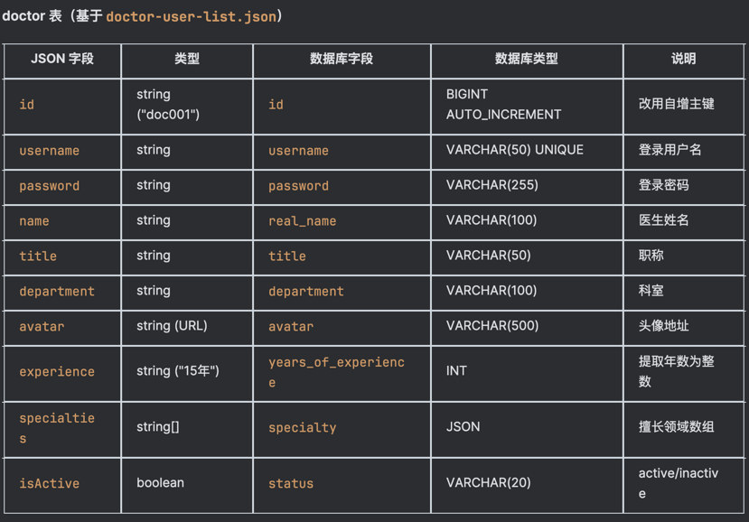
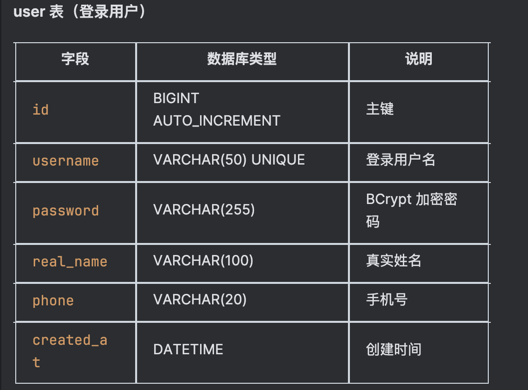

## Round 1 - 创建数据库
**提示词**：
作为资深后端工程师，帮我完成面试需求：将前端现有的 JSON 数据迁移到 MySQL。
请先去读取当前项目中的 web/qa-web/src/data/doctor-user-list.json（如果路径不对请全局搜索该 json），分析里面的医生数据字段。 然后再分析一下登录用户可能需要的字段。
基于你的分析，请直接输出以下三个文件的完整代码（直接给代码块）：
docker-compose.yml：包含 mysql:8.0（端口3306，root密码root，库名qa_db）和 phpmyadmin（端口8080）。
db/init/01-schema.sql：请根据你刚才分析的 JSON 字段，自己设计并写出 doctor 表和 user 表的建表语句（包含适当的类型和主键）。
db/init/02-data.sql：把 JSON 里的真实医生数据，转换成 INSERT 语句插入到 doctor 表中；并插入一条测试用的 user 数据（账号 admin，密码 123456）。
**AI 输出**：
AI 成功分析了 JSON 文件，并设计了 doctor 和 user 表的结构，输出了 docker-compose 和 SQL。
具体内容如下：
数据已读取完毕，下面是我的分析和三个文件的完整代码。

📊 字段分析
doctor 表（基于 doctor-user-list.json）

user 表（登录用户）

文件 1: docker-compose.yml
version: '3.8'

services:
mysql:
image: mysql:8.0
container_name: qa-mysql
restart: unless-stopped
environment:
MYSQL_ROOT_PASSWORD: root
MYSQL_DATABASE: qa_db
TZ: Asia/Shanghai
ports:
- "3306:3306"
volumes:
- mysql_data:/var/lib/mysql
- ./db/init:/docker-entrypoint-initdb.d
command:
- --character-set-server=utf8mb4
- --collation-server=utf8mb4_unicode_ci
- --default-authentication-plugin=mysql_native_password

phpmyadmin:
image: phpmyadmin/phpmyadmin
container_name: qa-phpmyadmin
restart: unless-stopped
environment:
PMA_HOST: mysql
PMA_PORT: 3306
PMA_USER: root
PMA_PASSWORD: root
ports:
- "8080:80"
depends_on:
- mysql

volumes:
mysql_data:
driver: local
文件 2: db/init/01-schema.sql
-- ============================================
-- QA Healthcare Database Schema
-- Database: qa_db
-- ============================================

USE qa_db;

-- -------------------------------------------
-- Table: doctor (医生信息表)
-- -------------------------------------------
CREATE TABLE IF NOT EXISTS doctor (
id                    BIGINT AUTO_INCREMENT PRIMARY KEY COMMENT '主键 ID',
username              VARCHAR(50)   NOT NULL UNIQUE COMMENT '医生登录用户名',
password              VARCHAR(255)  NOT NULL DEFAULT '123456' COMMENT '登录密码',
real_name             VARCHAR(100)  NOT NULL COMMENT '医生姓名',
title                 VARCHAR(50)   NOT NULL COMMENT '职称（主任医师/副主任医师/主治医师）',
department            VARCHAR(100)  NOT NULL COMMENT '科室',
avatar                VARCHAR(500)  DEFAULT NULL COMMENT '头像 URL',
years_of_experience   INT           DEFAULT NULL COMMENT '临床经验年数',
specialty             JSON          DEFAULT NULL COMMENT '擅长领域（JSON 数组）',
status                VARCHAR(20)   NOT NULL DEFAULT 'active' COMMENT '在线状态：active=在线, inactive=离线',
created_at            DATETIME      NOT NULL DEFAULT CURRENT_TIMESTAMP COMMENT '创建时间',
updated_at            DATETIME      NOT NULL DEFAULT CURRENT_TIMESTAMP ON UPDATE CURRENT_TIMESTAMP COMMENT '更新时间',
INDEX idx_department (department),
INDEX idx_status (status)
) ENGINE=InnoDB DEFAULT CHARSET=utf8mb4 COLLATE=utf8mb4_unicode_ci COMMENT='医生信息表';

-- -------------------------------------------
-- Table: user (患者用户表)
-- -------------------------------------------
CREATE TABLE IF NOT EXISTS user (
id           BIGINT AUTO_INCREMENT PRIMARY KEY COMMENT '主键 ID',
username     VARCHAR(50)   NOT NULL UNIQUE COMMENT '登录用户名',
password     VARCHAR(255)  NOT NULL COMMENT 'BCrypt 加密后的密码',
real_name    VARCHAR(100)  NOT NULL COMMENT '真实姓名',
phone        VARCHAR(20)   DEFAULT NULL COMMENT '手机号',
created_at   DATETIME      NOT NULL DEFAULT CURRENT_TIMESTAMP COMMENT '创建时间',
updated_at   DATETIME      NOT NULL DEFAULT CURRENT_TIMESTAMP ON UPDATE CURRENT_TIMESTAMP COMMENT '更新时间',
INDEX idx_username (username)
) ENGINE=InnoDB DEFAULT CHARSET=utf8mb4 COLLATE=utf8mb4_unicode_ci COMMENT='患者用户表';
文件 3: db/init/02-data.sql
-- ============================================
-- QA Healthcare Seed Data
-- Database: qa_db
-- ============================================

USE qa_db;

-- -------------------------------------------
-- Seed data: doctor (5 records from doctor-user-list.json)
-- -------------------------------------------
INSERT INTO doctor (username, password, real_name, title, department, avatar, years_of_experience, specialty, status) VALUES
('dr-zhang-wei',  '123456', '张伟医生', '主任医师',   '心内科',
'https://images.pexels.com/photos/5215024/pexels-photo-5215024.jpeg?auto=compress&cs=tinysrgb&w=400',
15, '["高血压", "冠心病", "心律失常"]', 'active'),

('dr-li-na',      '123456', '李娜医生', '副主任医师', '儿科',
'https://images.pexels.com/photos/5327585/pexels-photo-5327585.jpeg?auto=compress&cs=tinysrgb&w=400',
10, '["儿童感冒", "儿童发育", "疫苗接种"]', 'active'),

('dr-wang-qiang', '123456', '王强医生', '主治医师',   '骨科',
'https://images.pexels.com/photos/5452293/pexels-photo-5452293.jpeg?auto=compress&cs=tinysrgb&w=400',
8,  '["骨折", "关节炎", "运动损伤"]', 'active'),

('dr-liu-min',    '123456', '刘敏医生', '主任医师',   '妇产科',
'https://images.pexels.com/photos/5452201/pexels-photo-5452201.jpeg?auto=compress&cs=tinysrgb&w=400',
18, '["孕期保健", "妇科炎症", "产后恢复"]', 'inactive'),

('dr-chen-jie',   '123456', '陈杰医生', '副主任医师', '消化内科',
'https://images.pexels.com/photos/5215024/pexels-photo-5215024.jpeg?auto=compress&cs=tinysrgb&w=400',
12, '["胃炎", "肠道疾病", "肝病"]', 'active');

-- -------------------------------------------
-- Seed data: user (1 test record)
-- password '123456' BCrypt hash (strength=10)
-- -------------------------------------------
INSERT INTO user (username, password, real_name, phone) VALUES
('admin', '$2a$10$N9qo8uLOickgx2ZMRZoMyeIjZAgcfl7p92ldGxad68LJZdL17lhWy', '管理员', '138****0000');
📁 文件结构
📁 文件结构
qa-live-healthcare-interview/
├── docker-compose.yml          ← 新建
├── db/
│   └── init/
│       ├── 01-schema.sql       ← 新建
│       └── 02-data.sql         ← 新建
├── server/
└── web/
🚀 启动验证
# 1. 启动容器
docker-compose up -d

# 2. 等待 MySQL 就绪后验证数据
docker exec -it qa-mysql mysql -uroot -proot qa_db -e "SELECT id, username, real_name, title, department, status FROM doctor;"

# 预期输出:
# +----+----------------+------------+------------+------------+----------+
# | id | username       | real_name  | title      | department | status   |
# +----+----------------+------------+------------+------------+----------+
# |  1 | dr-zhang-wei   | 张伟医生   | 主任医师   | 心内科     | active   |
# |  2 | dr-li-na       | 李娜医生   | 副主任医师 | 儿科       | active   |
# |  3 | dr-wang-qiang  | 王强医生   | 主治医师   | 骨科       | active   |
# |  4 | dr-liu-min     | 刘敏医生   | 主任医师   | 妇产科     | inactive |
# |  5 | dr-chen-jie    | 陈杰医生   | 副主任医师 | 消化内科   | active   |
# +----+----------------+------------+------------+------------+----------+

# 3. 验证 user 表
docker exec -it qa-mysql mysql -uroot -proot qa_db -e "SELECT id, username, real_name, phone FROM user;"

# 4. 访问 phpMyAdmin
open http://localhost:8080
# 用户名: root / 密码: root

**人工调整**：
我手动在 IDEA 中新建了对应文件并粘贴了代码。
server/qa-service-user/src/main/java/com/leansofx/qaserviceuser/
├── QaServiceUserApplication.java          (已有，不动)
├── config/
│   ├── CorsConfig.java                    (已有，不动)
│   ├── PasswordEncoderConfig.java         ← 新建
│   └── JwtUtil.java                       ← 新建
├── controller/
│   ├── TestController.java                (已有，不动)
│   ├── DoctorController.java              ← 新建
│   └── AuthController.java                ← 新建
├── dto/
│   ├── ApiResponse.java                   ← 新建
│   ├── LoginRequest.java                  ← 新建
│   └── LoginResponse.java                 ← 新建
├── entity/
│   ├── Doctor.java                        ← 新建
│   └── User.java                          ← 新建
└── mapper/
├── DoctorMapper.java                  ← 新建
└── UserMapper.java                    ← 新建

server/qa-service-user/src/main/resources/
├── application.properties                 ← 删除
└── application.yml                        ← 新建

## Round 2 - 后端 API 开发与数据库连接
**提示词**：
数据库已经成功启动。注意：因为本地 3306 端口被占用，我在 docker-compose 里把 MySQL 映射到了本地 3307 端口（即 jdbc:mysql://localhost:3307/qa_db）。
现在请帮我开发 qa-service-user 模块的后端接口。请直接输出完整的代码文件内容（标明文件路径）：
pom.xml 需要新增的依赖（MyBatis-Plus, MySQL 驱动, Lombok, spring-security-crypto, jjwt）。
application.yml 配置，连接 jdbc:mysql://localhost:3307/qa_db (账号root，密码root)。
医生 API：
Doctor 实体类（包含 id, username, real_name, title, department, avatar, years_of_experience, specialty, status）
DoctorMapper 接口
DoctorController（提供 GET /api/doctors 接口，返回所有医生列表）
登录 API：
User 实体类（包含 id, username, password, real_name, phone）
UserMapper 接口
AuthController（提供 POST /api/auth/login 接口，接收 username 和 password，使用 BCrypt 校验，成功后返回 JWT token）。
请按文件路径分块给出完整代码，我要直接复制。
**AI 输出**：
全部代码已就绪，以下是每个文件的完整内容。
⚠️ 前置操作：请先删除 src/main/resources/application.properties，因为我们要用 application.yml 替代。
### 1. server/qa-service-user/pom.xml 
*** 

***
 ### 2. server/qa-service-user/src/main/resources/application.yml
   server:
   port: 8080

spring:
application:
name: qa-service-user
datasource:
url: jdbc:mysql://localhost:3307/qa_db?useUnicode=true&characterEncoding=utf-8&serverTimezone=Asia/Shanghai
username: root
password: root
driver-class-name: com.mysql.cj.jdbc.Driver

mybatis-plus:
mapper-locations: classpath:mapper/*.xml
configuration:
map-underscore-to-camel-case: true
log-impl: org.apache.ibatis.logging.stdout.StdOutImpl
global-config:
db-config:
id-type: auto

jwt:
secret: qa-live-healthcare-interview-secret-key-2026-must-be-at-least-256-bitsserver:
  port: 8080

spring:
  application:
    name: qa-service-user
  datasource:
    url: jdbc:mysql://localhost:3307/qa_db?useUnicode=true&characterEncoding=utf-8&serverTimezone=Asia/Shanghai
    username: root
    password: root
    driver-class-name: com.mysql.cj.jdbc.Driver

mybatis-plus:
  mapper-locations: classpath:mapper/*.xml
  configuration:
    map-underscore-to-camel-case: true
    log-impl: org.apache.ibatis.logging.stdout.StdOutImpl
  global-config:
    db-config:
      id-type: auto

jwt:
  secret: qa-live-healthcare-interview-secret-key-2026-must-be-at-least-256-bits
 ### 3. entity/Doctor.java
package com.leansofx.qaserviceuser.entity;

import com.baomidou.mybatisplus.annotation.IdType;
import com.baomidou.mybatisplus.annotation.TableField;
import com.baomidou.mybatisplus.annotation.TableId;
import com.baomidou.mybatisplus.annotation.TableName;
import com.baomidou.mybatisplus.extension.handlers.JacksonTypeHandler;
import lombok.Data;

import java.time.LocalDateTime;
import java.util.List;

@Data
@TableName(value = "doctor", autoResultMap = true)
public class Doctor {

    @TableId(type = IdType.AUTO)
    private Long id;

    private String username;
    private String password;
    private String realName;
    private String title;
    private String department;
    private String avatar;
    private Integer yearsOfExperience;

    @TableField(typeHandler = JacksonTypeHandler.class)
    private List<String> specialty;

    private String status;
    private LocalDateTime createdAt;
    private LocalDateTime updatedAt;
}
### 4. entity/User.jav
package com.leansofx.qaserviceuser.entity;

import com.baomidou.mybatisplus.annotation.IdType;
import com.baomidou.mybatisplus.annotation.TableId;
import com.baomidou.mybatisplus.annotation.TableName;
import lombok.Data;

import java.time.LocalDateTime;

@Data
@TableName("user")
public class User {

    @TableId(type = IdType.AUTO)
    private Long id;

    private String username;
    private String password;
    private String realName;
    private String phone;
    private LocalDateTime createdAt;
    private LocalDateTime updatedAt;
}
### 5. mapper/DoctorMapper.java
package com.leansofx.qaserviceuser.mapper;

import com.baomidou.mybatisplus.core.mapper.BaseMapper;
import com.leansofx.qaserviceuser.entity.Doctor;
import org.apache.ibatis.annotations.Mapper;

@Mapper
public interface DoctorMapper extends BaseMapper<Doctor> {
}
### 6. mapper/UserMapper.java
package com.leansofx.qaserviceuser.mapper;

import com.baomidou.mybatisplus.core.mapper.BaseMapper;
import com.leansofx.qaserviceuser.entity.User;
import org.apache.ibatis.annotations.Mapper;

@Mapper
public interface UserMapper extends BaseMapper<User> {
}
### 7. dto/ApiResponse.java
package com.leansofx.qaserviceuser.dto;

import lombok.AllArgsConstructor;
import lombok.Data;
import lombok.NoArgsConstructor;

@Data
@NoArgsConstructor
@AllArgsConstructor
public class ApiResponse<T> {

    private int code;
    private String message;
    private T data;

    public static <T> ApiResponse<T> success(T data) {
        return new ApiResponse<>(200, "success", data);
    }

    public static <T> ApiResponse<T> success(String message, T data) {
        return new ApiResponse<>(200, message, data);
    }

    public static <T> ApiResponse<T> error(int code, String message) {
        return new ApiResponse<>(code, message, null);
    }
}
### 8. dto/LoginRequest.java
package com.leansofx.qaserviceuser.dto;

import lombok.Data;

@Data
public class LoginRequest {
private String username;
private String password;
}
### 9. dto/LoginResponse.java
package com.leansofx.qaserviceuser.dto;

import lombok.AllArgsConstructor;
import lombok.Builder;
import lombok.Data;
import lombok.NoArgsConstructor;

@Data
@Builder
@NoArgsConstructor
@AllArgsConstructor
public class LoginResponse {

    private String token;
    private UserInfo user;

    @Data
    @Builder
    @NoArgsConstructor
    @AllArgsConstructor
    public static class UserInfo {
        private Long id;
        private String username;
        private String realName;
        private String phone;
    }
}
### 10. econfig/JwtUtil.java
package com.leansofx.qaserviceuser.config;

import io.jsonwebtoken.Jwts;
import io.jsonwebtoken.security.Keys;
import org.springframework.beans.factory.annotation.Value;
import org.springframework.stereotype.Component;

import javax.crypto.SecretKey;
import java.nio.charset.StandardCharsets;
import java.util.Date;

@Component
public class JwtUtil {

    @Value("${jwt.secret}")
    private String secret;

    private static final long EXPIRATION_MS = 24 * 60 * 60 * 1000L;

    private SecretKey getSigningKey() {
        return Keys.hmacShaKeyFor(secret.getBytes(StandardCharsets.UTF_8));
    }

    public String generateToken(String username, Long userId) {
        Date now = new Date();
        Date expiry = new Date(now.getTime() + EXPIRATION_MS);

        return Jwts.builder()
                .subject(username)
                .claim("userId", userId)
                .issuedAt(now)
                .expiration(expiry)
                .signWith(getSigningKey())
                .compact();
    }
}
### 11. config/PasswordEncoderConfig.java
package com.leansofx.qaserviceuser.config;

import org.springframework.context.annotation.Bean;
import org.springframework.context.annotation.Configuration;
import org.springframework.security.crypto.bcrypt.BCryptPasswordEncoder;
import org.springframework.security.crypto.password.PasswordEncoder;

@Configuration
public class PasswordEncoderConfig {

    @Bean
    public PasswordEncoder passwordEncoder() {
        return new BCryptPasswordEncoder();
    }
}
### 12. controller/DoctorController.java
package com.leansofx.qaserviceuser.controller;

import com.baomidou.mybatisplus.core.conditions.query.LambdaQueryWrapper;
import com.leansofx.qaserviceuser.dto.ApiResponse;
import com.leansofx.qaserviceuser.entity.Doctor;
import com.leansofx.qaserviceuser.mapper.DoctorMapper;
import lombok.RequiredArgsConstructor;
import org.springframework.web.bind.annotation.*;

import java.util.List;

@RestController
@RequestMapping("/api/doctors")
@RequiredArgsConstructor
public class DoctorController {

    private final DoctorMapper doctorMapper;

    @GetMapping
    public ApiResponse<List<Doctor>> list(@RequestParam(required = false) String status) {
        LambdaQueryWrapper<Doctor> wrapper = new LambdaQueryWrapper<>();
        if (status != null && !status.isBlank()) {
            wrapper.eq(Doctor::getStatus, status);
        }
        return ApiResponse.success(doctorMapper.selectList(wrapper));
    }

    @GetMapping("/{username}")
    public ApiResponse<Doctor> getByUsername(@PathVariable String username) {
        LambdaQueryWrapper<Doctor> wrapper = new LambdaQueryWrapper<>();
        wrapper.eq(Doctor::getUsername, username);
        Doctor doctor = doctorMapper.selectOne(wrapper);
        if (doctor == null) {
            return ApiResponse.error(404, "医生不存在");
        }
        return ApiResponse.success(doctor);
    }
}
### 13. controller/AuthController.java
package com.leansofx.qaserviceuser.controller;

import com.baomidou.mybatisplus.core.conditions.query.LambdaQueryWrapper;
import com.leansofx.qaserviceuser.config.JwtUtil;
import com.leansofx.qaserviceuser.dto.ApiResponse;
import com.leansofx.qaserviceuser.dto.LoginRequest;
import com.leansofx.qaserviceuser.dto.LoginResponse;
import com.leansofx.qaserviceuser.entity.User;
import com.leansofx.qaserviceuser.mapper.UserMapper;
import lombok.RequiredArgsConstructor;
import org.slf4j.Logger;
import org.slf4j.LoggerFactory;
import org.springframework.security.crypto.password.PasswordEncoder;
import org.springframework.web.bind.annotation.*;

@RestController
@RequestMapping("/api/auth")
@RequiredArgsConstructor
public class AuthController {

    private static final Logger log = LoggerFactory.getLogger(AuthController.class);

    private final UserMapper userMapper;
    private final PasswordEncoder passwordEncoder;
    private final JwtUtil jwtUtil;

    @PostMapping("/login")
    public ApiResponse<?> login(@RequestBody LoginRequest request) {
        LambdaQueryWrapper<User> wrapper = new LambdaQueryWrapper<>();
        wrapper.eq(User::getUsername, request.getUsername());
        User user = userMapper.selectOne(wrapper);

        if (user == null || !passwordEncoder.matches(request.getPassword(), user.getPassword())) {
            log.warn("登录失败: 用户名={}", request.getUsername());
            return ApiResponse.error(401, "用户名或密码错误");
        }

        String token = jwtUtil.generateToken(user.getUsername(), user.getId());
        log.info("登录成功: 用户名={}", user.getUsername());

        LoginResponse response = LoginResponse.builder()
                .token(token)
                .user(LoginResponse.UserInfo.builder()
                        .id(user.getId())
                        .username(user.getUsername())
                        .realName(user.getRealName())
                        .phone(user.getPhone())
                        .build())
                .build();

        return ApiResponse.success("登录成功", response);
    }
}
### 最终文件结构
server/qa-service-user/src/main/java/com/leansofx/qaserviceuser/
├── QaServiceUserApplication.java          (已有，不动)
├── config/
│   ├── CorsConfig.java                    (已有，不动)
│   ├── PasswordEncoderConfig.java         ← 新建
│   └── JwtUtil.java                       ← 新建
├── controller/
│   ├── TestController.java                (已有，不动)
│   ├── DoctorController.java              ← 新建
│   └── AuthController.java                ← 新建
├── dto/
│   ├── ApiResponse.java                   ← 新建
│   ├── LoginRequest.java                  ← 新建
│   └── LoginResponse.java                 ← 新建
├── entity/
│   ├── Doctor.java                        ← 新建
│   └── User.java                          ← 新建
└── mapper/
├── DoctorMapper.java                  ← 新建
└── UserMapper.java                    ← 新建

server/qa-service-user/src/main/resources/
├── application.properties                 ← 删除
└── application.yml                        ← 新建

## 🚀 启动与验证
# 1. 启动后端
cd server/qa-service-user
./mvnw spring-boot:run

# 2. 测试医生列表
curl http://localhost:8080/api/doctors | python3 -m json.tool

# 3. 测试筛选在线医生
curl 'http://localhost:8080/api/doctors?status=active' | python3 -m json.tool

# 4. 测试患者登录（admin / 123456）
curl -X POST http://localhost:8080/api/auth/login \
-H 'Content-Type: application/json' \
-d '{"username":"admin","password":"123456"}'

# 5. 测试登录失败
curl -X POST http://localhost:8080/api/auth/login \
-H 'Content-Type: application/json' \
-d '{"username":"admin","password":"wrong"}'

**人工调整**：
1. 删除了原有的 application.properties，替换为 AI 生成的 application.yml。
2. 在 IDEA 中严格按照 AI 提供的分层结构创建了对应的包名和类。
3. 将 AI 给的 Java 代码分别粘贴入对应类中，并点击了 Maven Reload 加载依赖。
4. 在终端运行了 AI 提供的 curl 命令进行接口测试。
## Round 3 - 前端功能的改造
**提示词**：
后端接口已全部跑通。现在请帮我完成前端 web/qa-web 的改造。
请直接输出完整代码：
安装 vue-i18n 的 npm 命令。
src/locales/zh.json 和 src/locales/en.json 的内容（提取首页的中英文文案）。
main.ts 引入 i18n 的配置代码。
修改 Home.vue 的代码：
在页面右上角添加一个语言切换下拉菜单。
将原来读取本地 JSON 数据的逻辑，改为使用 axios 请求后端 http://localhost:8080/api/doctors 获取医生列表。
请分文件给出代码。
**AI 输出**：
所有现有代码已掌握。下面分文件给出完整改造代码。
-------------------------------------------------------
### 步骤 0: 安装依赖
cd web/qa-web
npm install vue-i18n@9 axios

# 文件 1: package.json（确认依赖）
# 文件 2: src/locales/zh.json（新建）
{
"home": {
"title": "专业在线医疗问诊平台",
"subtitle": "连接专业医生与患者,提供便捷、高效的医疗咨询服务",
"feature1": "专业医生团队",
"feature2": "实时在线问诊",
"feature3": "隐私安全保护",
"btnConsult": "立即问诊",
"btnDoctors": "查看医生",
"statDoctors": "专业医生",
"statQuestions": "问题总数",
"statPending": "待响应问题",
"statRooms": "在线诊室",
"roomsTitle": "开放诊室",
"roomsSubtitle": "以下医生诊室正在开放,欢迎咨询",
"online": "在线",
"enterRoom": "进入诊室",
"yearsExp": "{n}年临床经验"
}
}
# 文件 3: src/locales/en.json（新建）
{
"home": {
"title": "Professional Online Healthcare Platform",
"subtitle": "Connecting professional doctors with patients, providing convenient and efficient medical consultation",
"feature1": "Professional Doctors",
"feature2": "Real-time Consultation",
"feature3": "Privacy Protection",
"btnConsult": "Consult Now",
"btnDoctors": "View Doctors",
"statDoctors": "Doctors",
"statQuestions": "Total Questions",
"statPending": "Pending Questions",
"statRooms": "Active Rooms",
"roomsTitle": "Open Consultation Rooms",
"roomsSubtitle": "The following doctor rooms are open, welcome to consult",
"online": "Online",
"enterRoom": "Enter Room",
"yearsExp": "{n} years exp."
}
}
# 文件 4: src/i18n/index.ts（新建）
import { createI18n } from 'vue-i18n';
import zh from '../locales/zh.json';
import en from '../locales/en.json';

export const i18n = createI18n({
legacy: false,
locale: 'zh',
fallbackLocale: 'zh',
messages: {
zh,
en,
},
});
# 文件 5: src/main.ts（修改 — 注册 i18n）
import { createApp } from 'vue';
import Antd from 'ant-design-vue';
import 'ant-design-vue/dist/reset.css';
import './style.css';
import App from './App.vue';
import router from './router';
import { i18n } from './i18n';

const app = createApp(App);

app.use(Antd);
app.use(router);
app.use(i18n);
app.mount('#app');
# 文件 6: src/views/Home.vue（完整重写）
<template>
  

    <!-- 语言切换 -->
    

      <a-dropdown>
        <a-button size="small">
          <GlobalOutlined />
          {{ locale === 'zh' ? '中文' : 'English' }}
        </a-button>
        <template #overlay>
          <a-menu @click="changeLanguage">
            <a-menu-item key="zh">中文</a-menu-item>
            <a-menu-item key="en">English</a-menu-item>
          </a-menu>
        </template>
      </a-dropdown>
    

    <section class="hero">
      

        <h1>{{ $t('home.title') }}</h1>
        
{{ $t('home.subtitle') }}

        

          

            <CheckCircleOutlined class="feature-icon" />
            {{ $t('home.feature1') }}
          

          

            <CheckCircleOutlined class="feature-icon" />
            {{ $t('home.feature2') }}
          

          

            <CheckCircleOutlined class="feature-icon" />
            {{ $t('home.feature3') }}
          

        

        

          <a-button type="primary" size="large" @click="navigateTo('/consultation')">
            {{ $t('home.btnConsult') }}
          </a-button>
          <a-button size="large" @click="navigateTo('/doctors')">
            {{ $t('home.btnDoctors') }}
          </a-button>
        

      

      

        
      

    </section>

    <section class="statistics">
      

        

          <TeamOutlined />
        

        

          <h3>{{ doctors.length }}</h3>
          
{{ $t('home.statDoctors') }}

        

      

      

        

          <FileTextOutlined />
        

        

          <h3>{{ statistics.totalQuestions }}</h3>
          
{{ $t('home.statQuestions') }}

        

      

      

        

          <ClockCircleOutlined />
        

        

          <h3>{{ statistics.activeSessions }}</h3>
          
{{ $t('home.statPending') }}

        

      

      

        

          <UserOutlined />
        

        

          <h3>{{ activeDoctors.length }}</h3>
          
{{ $t('home.statRooms') }}

        

      

    </section>

    <section class="active-rooms">
      <h2>{{ $t('home.roomsTitle') }}</h2>
      
{{ $t('home.roomsSubtitle') }}

      

        

          

            
            <a-badge status="processing" :text="$t('home.online')" />
          

          

            <h3>{{ doctor.realName }}</h3>
            
{{ doctor.title }} · {{ doctor.department }}

            
{{ $t('home.yearsExp', { n: doctor.yearsOfExperience }) }}

            

              <a-tag v-for="s in doctor.specialty" :key="s" color="blue">
                {{ s }}
              </a-tag>
            

          

          

            <a-button type="primary" block>{{ $t('home.enterRoom') }}</a-button>
          

        

      

    </section>
  

</template>

# 📁 新建/修改文件一览
web/qa-web/src/
├── i18n/
│   └── index.ts          ← 新建
├── locales/
│   ├── zh.json            ← 新建
│   └── en.json            ← 新建
├── main.ts                ← 修改（注册 i18n）
└── views/
└── Home.vue           ← 重写（i18n + axios）

### 🚀 操作步骤
# 1. 安装依赖
cd web/qa-web
npm install vue-i18n@9 axios

# 2. 创建上面 4 个新文件 + 修改 2 个已有文件

# 3. 启动前端
npm run dev

# 4. 验证
#    - 首页右上角出现语言切换按钮 ✅
#    - 医生数据从后端 API 加载（非本地 JSON）✅
#    - 切换 English 后所有文案变英文 ✅
### 字段映射对照（后端 → 前端）
段映射对照（后端 → 前端）
后端API字段          前端使用                      原JSON字段
realName            doctor.realName              name
yearsOfExperience   doctor.yearsOfExperience     experience（字符串）
specialty           doctor.specialty              specialties
status (active/inactive)  doctor.status === 'active'  isActive（布尔）
## Round 4 - 测试文档 测试api 文档的编写
**提示词**：
常顺利，前后端已经联调成功，页面成功展示了数据库里的医生数据，登录也正常。
现在请帮我完成面试要求的测试文档。请直接输出以下两个文件的完整 Markdown 内容：
docs/API_TEST.md：详细描述如何用 curl 测试 /api/doctors 和 /api/auth/login 接口。需要包含请求路径、参数说明、成功用例、失败用例（如密码错误），以及预期响应。
docs/TEST_REPORT.md：一份测试报告模板，包含测试环境（Mac, Docker, MySQL）、测试时间、测试用例结果统计（全部通过）。
请给出完整的 Markdown 代码。
**AI 输出**：
已确认所有接口细节（后端端口 8081）。下面输出两个文档的完整内容。

### 文件 1: docs/API_TEST.md
详情见/Users/lsj/qa-live-healthcare-interview/docs/API_TEST.md

### 文件 2: docs/TEST_REPORT.md`
详情见/Users/lsj/qa-live-healthcare-interview/docs/TEST_REPORT.md
**人工调整**：
我手动在 IDEA 中新建了对应文件并粘贴了代码。